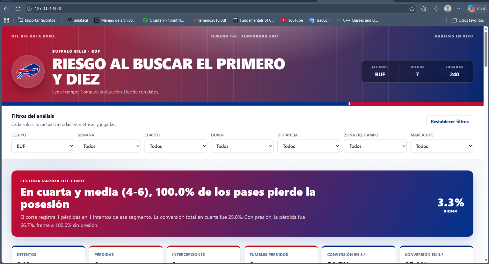

# Riesgo al buscar el primero y diez

Hackathon NFL Big Data Bowl, UNAM. Dashboard web que muestra en qué situaciones un equipo pierde la posesión al intentar alcanzar el primero y diez, con un enfoque de head coach.



*Dashboard ejecutándose en local, filtrado por Buffalo Bills (BUF): 7 juegos y 240 jugadas. Se ven los filtros, la lectura rápida del corte y los indicadores principales.*

## Pregunta detonadora

**¿En qué situaciones un equipo perdió la posesión del balón al intentar avanzar a la marca del primero y diez?**

Pregunta refinada para el análisis:

> ¿En qué combinaciones de down, distancia, zona del campo, marcador, presión y cobertura pierde la ofensiva la posesión al intentar conseguir un nuevo primero y diez, y qué decisión de jugada reduce ese riesgo sin sacrificar la probabilidad de conversión?

## Objetivos

1. Identificar en qué situaciones se pierde la posesión: intercepción, fumble perdido o fallo en cuarta oportunidad.
2. Medir cómo cambian la conversión y la pérdida según distancia, down, presión, zona del campo y marcador.
3. Comparar decisiones observadas (formación y play action) para apoyar la toma de decisiones de un head coach.
4. Presentar los resultados en un dashboard interactivo que cualquier persona del cuerpo técnico pueda leer sin tocar los datos.

## Datos

Temporada 2021, semanas 1 a 8, 122 juegos. Los archivos están en `data/` y son de solo lectura.

| Archivo | Contenido | Uso en el análisis |
|---|---|---|
| `plays.csv` | 8,557 jugadas de pase con situación, formación, cobertura y resultado | Tabla principal |
| `games.csv` | 122 juegos con semana y equipos local y visitante | Semana y marcador desde la perspectiva del ataque |
| `pffScoutingData.csv` | Una fila por jugador por jugada | Presión sobre el pasador |
| `players.csv` | 1,679 jugadores | No se usa todavía |
| `tracking/` | Una carpeta con 122 archivos de seguimiento por fotograma, unos 858 MB | No se usa todavía |

El conjunto contiene solo jugadas de pase. No hay carreras, despejes ni goles de campo.

## Método

### Universo

- Se parte de 8,557 jugadas de pase.
- Se excluyen las jugadas cuyo resultado final es `No Play`. Si el texto contiene una reversión, se usa solo lo que sigue a la última.
- Quedan **8,068 pases válidos**.

### Qué cuenta como pérdida de posesión

| Tipo | Regla |
|---|---|
| Intercepción | `passResult = IN`, salvo que el ataque recupere el balón en un fumble posterior |
| Fumble perdido | El texto de la jugada indica un fumble y la última recuperación es del equipo defensor |
| Pérdida por downs | Cuarta oportunidad, sin penalización defensiva aceptada, con `playResult` menor que `yardsToGo`, y que no sea intercepción ni fumble |

### Qué cuenta como conversión

Tercera o cuarta oportunidad en la que la jugada alcanza `yardsToGo`, o en la que hay una penalización defensiva aceptada, y que no termina en pérdida de posesión.

### Variables derivadas

- **Distancia:** corta (1–3), media (4–6), larga (7–10) y muy larga (11+).
- **Zona del campo:** yarda propia 1–19, territorio propio 20–39, medio campo 40–60, territorio rival 39–21 y zona roja rival. Se calcula con `possessionTeam`, `yardlineSide` y `yardlineNumber`.
- **Marcador:** perdiendo, empatado o ganando, desde la perspectiva del equipo con la posesión.
- **Presión:** una jugada tiene presión si algún jugador con rol `Pass Rush` en `pffScoutingData.csv` registra hit, hurry o sack.

### Cálculo

Todo se calcula en el backend con pandas. El frontend solo muestra lo que devuelve la API y no recalcula métricas.

## Qué encontramos

Cifras para toda la liga con los datos cargados.

**Pérdidas de posesión: 353 en 8,068 pases válidos (4.4%).**

| Motivo | Casos |
|---|---:|
| Intercepciones | 175 |
| Fumbles perdidos | 62 |
| Pérdidas por downs | 116 |

### 1. En cuarta oportunidad se pierde la posesión en más de la mitad de los casos

| Distancia en cuarta | Intentos | Conversión | Pérdida |
|---|---:|---:|---:|
| 1–3 yardas | 94 | 52.1% | 47.9% |
| 4–6 yardas | 56 | 39.3% | 60.7% |
| 7–10 yardas | 40 | 40.0% | 60.0% |
| 11+ yardas | 28 | 25.0% | 75.0% |
| **Total** | **218** | **43.1%** | **56.9%** |

### 2. Llegar a tercera y largo reduce mucho la conversión

| Distancia en tercera | Intentos | Conversión |
|---|---:|---:|
| 1–3 yardas | 437 | 56.8% |
| 4–6 yardas | 639 | 44.6% |
| 7–10 yardas | 758 | 35.0% |
| 11+ yardas | 400 | 19.2% |

### 3. La presión sobre el pasador empeora los resultados

En tercera y cuarta oportunidad combinadas:

| | Intentos | Conversión | Pérdida |
|---|---:|---:|---:|
| Sin presión | 1,352 | 49.0% | 6.2% |
| Con presión | 1,100 | 27.8% | 11.1% |

En cuarta oportunidad, la pérdida fue de **67.0% con presión** frente a **45.6% sin presión**.

### 4. Los sacks son el escenario con más riesgo de fumble

En un análisis exploratorio previo, el fumble perdido ocurrió en 6.15% de los sacks (32 de 520), frente a 0.58% de los pases completos. Esta cifra no aparece en el dashboard.

### Recomendaciones para el head coach

- Evitar llegar a tercera y larga: un primer o segundo down que pierde yardas o termina en sack reduce las opciones.
- Tratar la protección como parte de la decisión, no solo de la ejecución: identificar la presión y tener una ruta caliente o salida rápida.
- En cuarta, usar rutas que lleguen a la línea por ganar. Hubo pases completos que quedaron cortos.
- Evitar pases en cuarta y 11+, salvo que el marcador y el tiempo obliguen.

## Cómo lo sabemos

- Las cifras salen de contar jugadas reales de `plays.csv` con las reglas descritas arriba. No hay estimaciones ni simulaciones.
- Las cifras se calcularon dos veces con código independiente: un análisis exploratorio con la librería estándar de Python y el backend con pandas. Coinciden en 8,068 pases válidos, 353 pérdidas, 175 intercepciones, 62 fumbles, 116 pérdidas por downs y 218 intentos de cuarta. La conversión de cuarta quedó en 94 casos en el backend, porque este cuenta una penalización defensiva aceptada como conversión.
- La API se probó por HTTP: responde 200 con filtros válidos y 422 con filtros inválidos.
- El build del frontend compila con TypeScript estricto.
- El comando `.\.hackathon\setup.cmd --check` reporta que el proyecto sigue el stack del evento.
- Cada pérdida se puede revisar en la tabla de jugadas del dashboard, con su descripción original.

## Limitaciones

- **Solo pases.** No se puede comparar pasar contra correr, ni contra despejar o patear gol de campo.
- **Descriptivo, no causal.** Las diferencias muestran asociaciones. Por ejemplo, un equipo que usa play action puede hacerlo en situaciones distintas.
- **Muestras pequeñas.** Con 8 semanas, muchos cortes tienen pocos intentos. La tabla de decisiones muestra una advertencia debajo de 10 intentos. El titular automático todavía puede apoyarse en una muestra pequeña cuando se filtra por equipo.
- **Fumbles detectados por texto.** No existe una columna de recuperación. Se leen en `playDescription` y algunos casos raros pueden clasificarse mal.
- **Penalizaciones.** Una penalización aceptada puede cambiar el resultado de la jugada. El análisis excluye las jugadas anuladas y trata la penalización defensiva aceptada como no pérdida. Es una aproximación.
- **Presión.** Se mide con la clasificación de PFF, que ocurre después de la decisión. Sirve para explicar un resultado, no como dato conocido antes del snap.

## Cómo ejecutarlo

Requisitos: Windows y conexión a internet solo la primera vez, para preparar el entorno.

### 1. Preparar el entorno (una sola vez)

Desde la raíz del proyecto:

```powershell
.\.hackathon\setup.cmd
```

Instala Python 3.12.12, Node 22.23.1 y todas las dependencias fijadas, sin tocar tu instalación del sistema. Puede tardar varios minutos.

### 2. Opción A: un solo servidor

El build ya está en `dashboard\dist` y el backend lo sirve junto con la API.

```powershell
.\.venv\Scripts\python.exe -m uvicorn backend.main:app --port 8000
```

Abre **http://localhost:8000**. La primera carga tarda unos segundos mientras se leen los CSV.

### 2. Opción B: desarrollo con dos terminales

Terminal 1, en la raíz:

```powershell
.\.venv\Scripts\python.exe -m uvicorn backend.main:app --reload --port 8000
```

Terminal 2, en `dashboard`:

```powershell
..\.hackathon\.tools\node\npm.cmd run dev
```

Abre la dirección que imprime Vite, normalmente **http://localhost:5173**. Vite redirige las llamadas `/api` al puerto 8000.

### Recompilar el frontend

```powershell
cd dashboard
..\.hackathon\.tools\node\npm.cmd run build
```

### Verificar y entregar

```powershell
.\.hackathon\setup.cmd --check
.\.hackathon\setup.cmd --entregar
```

### Problemas frecuentes

- **`WinError 10013` al arrancar:** el puerto 8000 está ocupado o reservado. Revisa qué lo usa con `Get-NetTCPConnection -LocalPort 8000`, o usa otro puerto. Si cambias el puerto, actualiza el proxy de `dashboard/vite.config.ts`.
- **El dashboard no muestra datos:** comprueba que el backend esté en ejecución y que `http://localhost:8000/health` responda `{"status":"ok"}`.

## API

| Endpoint | Descripción |
|---|---|
| `GET /health` | Devuelve `{"status": "ok"}` |
| `GET /api/dashboard` | Métricas, gráficas, decisiones y jugadas del corte solicitado |

Filtros opcionales de `/api/dashboard`: `team`, `week`, `quarter`, `down`, `distance`, `field_zone`, `score_state`. Un valor inválido devuelve 422.

## Estructura del proyecto

```
backend/
  main.py          API FastAPI y servidor del build del dashboard
  analysis.py      Carga de datos, reglas de pérdida y agregaciones
dashboard/
  src/
    App.tsx        Página principal
    api.ts         Llamada a la API (ruta relativa api/dashboard)
    types.ts       Contrato de datos
    format.ts      Formato de números y etiquetas
    components/    Filtros, tarjetas, gráficas y tablas
data/              Datos originales, solo lectura
.hackathon/        Herramientas y reglas del evento
```

## Stack

Python 3.12.12, FastAPI 0.115.14, Uvicorn 0.34.3, Pydantic 2.11.7, pandas 2.2.3, numpy 2.1.3, React 18.3.1, Vite 5.4.21, TypeScript 5.7.3, Tailwind CSS 3.4.19 y Recharts 3.10.1. No se usa IA.

## Equipo

| Rol | Responsabilidad |
|---|---|
| Backend y análisis | `backend/`: reglas de pérdida, cálculos, filtros y estabilidad del contrato JSON |
| Frontend y visualización | `dashboard/src/`: filtros, gráficas, tablas y diseño |

Los cambios al contrato de `GET /api/dashboard` se acuerdan entre ambos.
